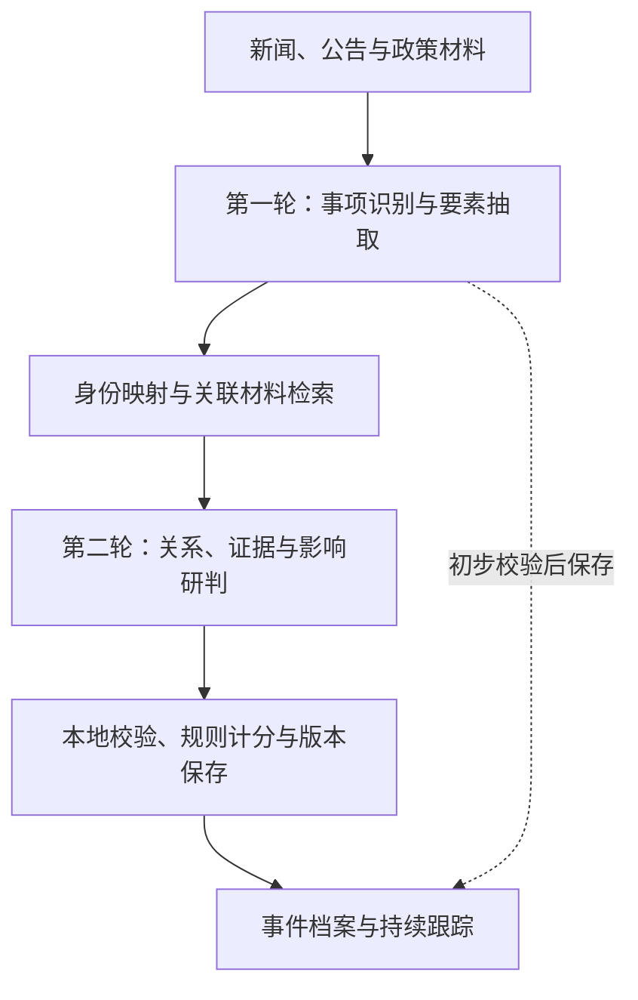
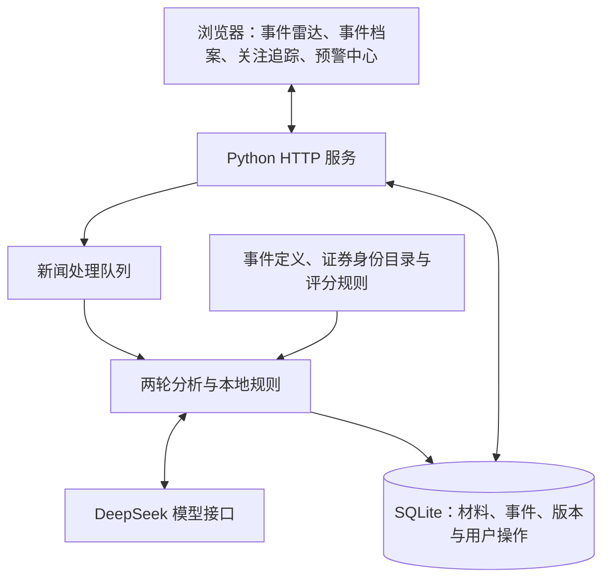

# 技术报告

## 一、问题理解

### 从分散报道到可追踪的事件

金融信息分散在新闻、公告和政策材料中。使用者既要知道发生了什么，也要判断涉及哪些公司或行业、依据是否充分、业务进展到了哪一步，以及是否需要及时关注。本项目围绕这些问题，将原始材料整理为有证据、有时间线、有影响分析的事件档案。

处理单位是具体业务事项。同一药物的审批报道可以持续归入一个档案，不同药物分别建档；同一项目的投资决定和承包商任命属于不同进展；转载增加材料，澄清更新原有说法。这样，分析结果能随新材料连续更新。

### 六项任务与七项输出

| 任务 | 处理内容 |
| --- | --- |
| 多源事件识别 | 识别新闻、公告、政策中的具体事项，区分主事件与背景。 |
| 要素抽取与标准化 | 提取主体、时间、影响对象和方向，统一名称与身份。 |
| 可信度评估与辨伪 | 逐条核对重要说法，整理来源、支持证据和冲突。 |
| 同源聚合与去重 | 将同一事项归入同一档案，区分不同项目、药物和交易。 |
| 事件脉络追踪 | 保存新进展、历史补充和更正，形成连续时间线。 |
| 影响分级与预警 | 按具体对象分析影响，在重要事实发生变化时提醒。 |

输入为材料标题、正文、来源、发布时间及可获得的链接。事件档案统一呈现七项内容：事件摘要、事件主体、影响对象、可信度、证据来源、事件时间线和预警理由。

### 分析中需要分清的关系

主体回答“谁参与了事件”，影响对象回答“谁受到作用”。可信度评价证据支持程度，影响分评价业务重要性。业务发生时间用于排列进展，材料可用时间用于保留当时判断。共同引用同一公告的多篇报道按同一来源链处理，关注、已读和关闭提醒等操作单独保存。

## 二、技术路线

### 一次识别，一次综合研判

系统采用“两次大模型分析、程序规则处理”的流程。第一次从原文抽取事件和要素；程序完成身份映射与关联检索；第二次集中判断事项关系、证据支持和对象影响；最后由程序校验、计分、更新档案并生成提醒。

大模型负责理解原文、比较事项和解释影响路径。程序负责核对引用、映射目录、计算分值、保存版本和控制重复提醒。第一次抽取通过校验后即可保存事件信息，综合研判继续补充证据、关系和影响分析。

## 三、系统架构

系统由浏览器工作台、Python本地服务、分析与规则模块、SQLite记录库及规则目录组成。前端使用HTML、CSS和JavaScript；后端使用Python标准库HTTP服务与任务线程，模型请求通过统一入口发送。

### 界面与处理流程

四个页面共享同一套事件数据。事件雷达用于浏览和筛选，事件档案展示证据与时间线，关注追踪保存观察对象和待办，预警中心呈现提醒及更正。材料提交后进入处理队列，页面通过状态接口获取进度和结果。

### 目录与规则

| 组成 | 规模 | 用途 |
| --- | --- | --- |
| 事件定义 | 120项 | 约束事件类别和对应业务含义。 |
| 证券身份记录 | 8,175条 | 统一公司名称、简称、证券代码及相关身份。 |
| 行业目录 | 17类 | 规范行业影响对象及原文判断依据。 |
| 业务影响细则 | 18类 | 为不同事件选择适用的影响评分档位。 |

### 记录与持续更新

SQLite采用WAL模式，支持分析写入期间读取已有档案。原文、分析答复、事件快照、预警版本和用户操作分别记录。更新保留前后依据，重复提交复用已有记录，逐条核验通过的事项可独立保存。

## 四、核心算法

四项方法围绕同一事件档案运行：识别具体事项，核对事实依据，归并相关报道，再按对象影响和事实变化生成预警。模型提供语义判断，程序检查依据并计算结果。

### 1. 事件识别模型

采用DeepSeek Flash，结合提示模板、120条官方对象与事件定义、证券身份目录和固定JSON字段完成任务适配。一次分析分为事项识别和综合判断两轮。

事项识别：第一轮先按定义找候选，再提取主体、动作、项目或交易标识、阶段、时间、金额、核心事实、影响对象及方向。同一业务决定的参数、用途和预期作用随事项保存；独立项目或交易分别提取。证券代码由程序查表确定，全称、简称、英文别名及品牌、子公司关系辅助绑定；行业对象结合业务描述与17类目录匹配。

综合判断：第二轮将已提取事项与本地检索结果一起比较，给出逐条事实的证据关系、同一事项的关联判断，以及每个对象的影响依据。程序检查字段、原句位置、关键数值和材料绑定；第一轮有依据的事项先行入档，第二轮补充核验、关联和影响结果。

三类检索分别服务于分类、核验和关联：

| 检索内容 | 具体方法与参数 | 提供给模型的内容 |
| --- | --- | --- |
| 事件定义 | 较少出现的词赋予更高权重（IDF），结合对象命中和句内主题覆盖；每个标题或正文范围最多取5条候选。 | 定义条件、命中词和原文范围。 |
| 证据材料 | 先匹配参与方和事项标识，再按共享词项数加4倍具名对象命中数排序；正文窗口700字符、步长620字符，每事项取前3份。 | 相关材料及原句位置。 |
| 已有档案 | 精确事项标识匹配与对象限定的BM25检索并用；k1＝1.5、b＝0.75，BM25通道取前10个事项。 | 候选档案、阶段与比较依据。 |

定义候选的句内筛选要求对象与事件主题共现，或至少两个有效主题词且覆盖度达到0.5；模型继续核对具体定义条件，保存匹配结果及原文依据。

### 2. 可信度评估方法

采用主张级多源证据加权评分。先把新闻拆为主体、事项和阶段明确的事实主张，再把材料标为支持、反证、相关或依据不足，逐项核对出处、适用范围和材料可用时间。分数表示当前证据对该主张的支持强度。

计分规则：原始分＝50＋来源S＋适用证据E＋独立印证I＋传播溯源P－问题D。最终分限制在0—95分，并执行所有适用上限中的最低值。

| 分项 | 取值 | 主要判据 |
| --- | --- | --- |
| 来源 S | 0、5、10、15、20 | 依次对应身份未明、承载平台、可识别发布者、已核专业媒体或当事方、适用的正式披露或主管机构。 |
| 适用证据 E | 0、5、10、15、20 | 依次对应无适用支持、间接线索、已核报道依据、具名披露转述或直接材料、适用原始记录。 |
| 独立印证 I | 0、5、10 | 主链之外每增加一个经核对的独立信息源头加5分，最多10分。 |
| 传播溯源 P | 0、3、5 | 依次对应出处待核、上游具名、原始出处与引用关系及材料时间核对完整。 |
| 问题 D | 0、10、20、40 | 无已核问题不扣分；关键限定不符扣10，未解决的事实冲突扣20，适用原始记录直接反驳且无未解决的合格直接支持时扣40。 |

具名披露转述最高89分；仅有报道陈述或间接线索最高79分；来源身份未明且适用证据低于10分，最高59分。关键限定不符、未解决冲突及原始记录直接反驳，分别适用59、49和19分上限。扣分按已核问题计算，同一根因只计一次。

证据合并：来源、适用证据和传播溯源来自同一条证据链；共享公告或同一原稿的转载归为一个源头。同一主张先合并材料重新评分，事件可信度再取当前核心主张中的最低分，历史和附属主张分别展示。档案保留分项、上限、决定分数的主张及对应原句。

例如，已核身份的专业媒体具体转述具名披露，来源15、证据15、溯源3，得到50＋15＋15＋3＝83分；补入适用原始记录后，按原件链得到50＋20＋20＋5＝95分。结果分为偏低（0—49）、依据有限（50—64）、中等（65—79）、较高（80—89）和高（90—95）五档。

### 3. 聚合去重方法

采用输入指纹去重与事项身份归并。提交层根据标题、正文、来源和发布时间生成指纹，重复输入复用已有处理记录。事件层以公司、药物、项目、交易标的、债券期次或报告期等具体标识找候选，再比较事项身份、业务阶段与新增事实。

模型给出关系建议和双方原文依据，程序检查身份字段、事实差量及时间关系。有效关系形成事件簇，合并前复查整簇是否含已确认的不同事项、明确身份冲突或时间顺序循环。确认属于同一事项后，按下表更新档案。

| 更新方式 | 处理规则 |
| --- | --- |
| 材料增加 | 转载或等价报道加入已有节点，保留来源，沿用业务内容。 |
| 事实补充 | 同阶段增加有依据的日期、金额或范围，追加内容版本。 |
| 业务进展 | 出现新的业务动作或阶段，增加时间线节点。 |
| 历史补报 | 将早期进展放回对应节点，保留首次获知时点及已有后续状态。 |
| 主张更正 | 绑定旧说法、新说法和更正依据，保存前后版本。 |
| 主张冲突 | 并列保存相反说法及依据，进入核查处理。 |

同一公司不同药物或交易分别建档；同一药物从受理到批准可形成连续节点。身份依据不足时保存候选和待核原因。发生时间用于组织业务顺序，披露、计划和材料可用时间分别保存；业务节点、内容版本与预警版本独立记录。

### 4. 预警规则说明

采用四项影响评分、18类业务细则和前后变化比较。以“事件、对象、阶段”为单位，分别分析利好、负面、混合或中性影响及传导路径，按原文依据选择评分档位，由程序求和。

| 评分维度 | 可选分值 | 判断内容 |
| --- | --- | --- |
| K 事件性质 | 0、10、20、30 | 从一般业务变化到核心经营条件、控制权、准入或偿付变化。 |
| M 对象影响范围 | 0、5、10、20、30 | 核对直接或传导关系，以及对该对象实际涉及的业务范围。 |
| S 业务阶段 | 0、5、10、15、20、25 | 区分设想、程序性进展、关键验证、实施和已实现结果。 |
| T 时间敏感性 | 0、5、10、15 | 无新增窗口0、长期观察5、影响当前判断10；经交易日历核对的5个交易日内有效期限，或持续严重障碍15。 |

四项最高分别为30、30、25、15分，总分100分。可量化的影响范围使用相同单位、期间和权益口径：新增规模占事件前基数不足1%、1%—不足5%、5%—不足30%、30%及以上，分别对应M项5、10、20、30分；其他情况按业务细则判断。未确定的维度保留分值区间，基础等级按已支持的下界确定。

| 基础等级 | 分值条件 | 处理方式 |
| --- | --- | --- |
| 灰色·记录 | 0—39分 | 保存事件与材料。 |
| 黄色·关注 | 40—59分 | 进入预警中心，结合关注设置汇总。 |
| 橙色·重要 | 60—79分；达到80分且T低于15分时仍属此档 | 生成重要提醒。 |
| 红色·紧急 | 80分及以上，且T＝15 | 优先生成紧急提醒。 |

业务优先与证据检查：重大重组或控制权事项正式推进、交割、否决或终止，以及首次商业上市许可、核心经营许可等关键准入取得，满足细则后至少为橙色。有直接对象关系和适用依据的重大偿付失败、严重持续经营障碍等，触发红色。证据分为待核线索、具体报道依据和适用原始依据；程序结合对象关系与冲突状态确定预警，重要待核线索生成核查事项。

持续更新：与上次实际送达的事实比较：首次达到条件、关键阶段变化、关键事实确认、反转或范围改变、等级变化或累计分数变化至少15分，均可形成更新。更正关联原提醒，保存旧说法、新说法及纠正范围；重要节点到期形成核查事项。转载只更新材料。一次处理命中多个条件合并为一个预警版本，应用内通知结合关注与静音设置生成。

## 五、关键模块

| 模块 | 主要功能 | 产出 |
| --- | --- | --- |
| 材料接收 | 支持粘贴文本及CSV、XLSX导入，预览并检查标题、正文、来源和时间。 | 原始材料、导入状态。 |
| 任务调度 | 管理两次模型调用、处理时限和进度，重复提交复用记录。 | 任务状态、请求与答复记录。 |
| 识别与对象映射 | 按定义抽取事项，校验原句，匹配证券名录和行业目录。 | 事件要素、标准对象、原文引用。 |
| 关联与证据核验 | 检索候选档案，比较事项和事实，核对来源及支持关系。 | 关联结论、证据明细、可信度。 |
| 影响与预警 | 解释业务影响，计算四项分值，比较新事实并管理提醒。 | 影响方向、评分、预警理由。 |
| 档案与交互 | 保存时间线和历史快照，支持原文高亮、关注、已读、待办与关闭提醒。 | 七项输出、历史记录、操作状态。 |

例如，输入某药物获批的报道后，系统识别药物和审批节点，匹配相关公司，保存依据并分析商业化影响；后续转载归入同一档案，新适应症或新的审批进展重新比较事项与阶段，形成相应记录和提醒。

## 六、实验设计

### 测试规模与样本组织

项目从数据准备、方案对照到整段流程与页面交互，持续开展数十轮开发验证。本地完成20万级新闻资料的整理、全文索引与重复分组，生成3万余条不同类型的重复关系记录。模型实验累计记录400余篇次新闻处理与阶段对照、1,200余次真实模型发送，并完成1,445处原文定位检查。

新闻验证按篇次统计，同一材料在不同轮次或对照组中的处理分别计入。近期固定案例经过5轮复验；两批随机测评与训练诊断共使用120篇互不重复的新闻。主要测试安排如下。

| 测试内容 | 规模 | 主要目的 |
| --- | --- | --- |
| 本地数据处理 | 20万级材料；3万余条关系记录 | 建立全文索引并按重复关系分组。 |
| 前期方案对照 | 7组，累计210篇次 | 对照抽取、匹配、提示及推理模式。 |
| 代表场景连续验证 | 40余篇次 | 检查转载、进展和已有档案更新。 |
| 固定流程复验 | 5轮，每轮10次提交 | 复验重复、多事项及结果接收。 |
| 首轮随机测评 | 30篇：个股18、行业12 | 比较对象、方向与事件类别。 |
| 训练材料诊断 | 60篇：个股47、行业13 | 调整提示、身份映射与接收规则。 |
| 新一轮同批评估 | 30篇：个股23、行业7 | 同批材料分别比较程序与对话判断。 |

首轮在1,029篇去重有效材料中抽样；新一轮排除已使用正文后，候选池为999篇。三批随机材料的种子分别为20261009、2026100960和2026100930。每篇程序任务使用独立工作库，保留当批程序、请求、答复、耗时及档案记录。识别读取原文和规则，参考标签用于完成后的对照；对话判断在标签对照前保存。

### 全流程与关键场景

测试既检查一篇新闻如何进入事件档案，也检查新材料如何改变已有档案。正常输入沿完整流程运行；保存答复回放和异常注入用于复现引用、格式、超时及迟到答复等情况，观察有效事项的保存和任务收尾。

| 验证环节 | 主要场景 | 观察内容 |
| --- | --- | --- |
| 接收与任务调度 | 重复提交、处理超时、迟到答复 | 材料查重、已有结果保存及处理状态更新。 |
| 事件与对象抽取 | 主要事项与背景、标题公司名、行业推断 | 原句绑定、身份映射与事项拆分。 |
| 聚合与时间线 | 转载、不同药物或项目、新进展与历史补报 | 事项归属、节点顺序及历史快照。 |
| 证据与影响评分 | 引文定位、来源依赖、对象和阶段变化 | 证据明细、可信度规则及四项影响分。 |
| 预警与用户操作 | 新事实提醒、关注、已读、待办及关闭预警 | 提醒更新、用户状态保存与事件事实一致性。 |

展示验证另外使用150篇新闻材料，形成160份档案。逐份检查七项输出、版本签名和原文入口，并在实际浏览器中检查四页、筛选、分页、证据回看及设置保存。数据库完整性和操作前后的事实一致性同时纳入检查。前期业务参考还对40篇材料的456条断言、376项数量字段和1,445处引文位置进行了校验。

### 评价口径

识别效果按公司对象、行业对象、全部对象、对象与方向、对象与类别及三项联合一致率统计。运行效率记录从提交到本轮后台处理结束的时间、模型发送次数和档案读取情况。回放及页面检查按对应功能项记录，形成从语义判断到实际使用的评价结果。

## 七、效果评估

### 对话识别结果

本组从官方带标签测试材料中随机选取新闻，与官方标签保存的对话识别判断与参考对象、影响方向及事件类别逐项对照，结果如下。

| 评估项目 | 一致率 |
| --- | --- |
| 个股公司对象一致 | 91.3% |
| 行业新闻对象一致 | 85.7% |
| 全部新闻对象一致 | 90.0% |
| 对象与影响方向同时一致 | 83.3% |
| 对象与事件类别同时一致 | 80.0% |

对象按规范名称或代码匹配，方向和类别对应同一对象；一篇新闻有多项参考标注时，按整篇命中情况比较。

### 系统运行与功能验证

新一轮30篇程序运行生成28份可读档案，档案可读率为93.3%。平均处理64.50秒，中位数60.44秒，最长89.27秒；每篇最多2次模型发送，本批共58次。计时从分析提交到本轮后台处理结束。

| 验证项目 | 结果 |
| --- | --- |
| 本地资料整理与全文索引 | 203,579条材料完成入库、全文索引及来源回查。 |
| 本地重复分组 | 形成187,924个文档组，保存30,899条不同类型的重复关系记录。 |
| 核心程序及共性检查 | 引用、身份、返回格式等21项核心和9项共性检查通过。 |
| 展示档案与记录完整性 | 160份档案的必要输出与版本签名齐全，数据库完整性正常。 |
| 行业展示覆盖 | 50篇材料覆盖17类行业，原文与参考字段逐条核对。 |
| 证据与历史回看 | 引文展开、高亮、历史快照和时间线回看通过。 |
| 用户状态与设置保存 | 关注、已读、待办、关闭预警和设置保存通过。 |
| 四页浏览器交互 | 四页浏览、筛选及分页检查通过，页面脚本错误0。 |

王府井案例包含4篇报道和6组关联比较，整理为新进展、转载或等价报道、历史补报3个关系入口。三个时间线节点与原文可以逐项查看，展示同一事项随新材料更新的过程。

## 八、不足分析

行业传导、公司简称及繁体名称的映射仍需完善。后续优先补充有来源的身份关系，细化发布机构与受影响对象的区分，并用分行业样本统一类别和方向口径。

复杂材料的局部引用或返回格式有时会影响主要结果接收。下一步继续完善逐事项校验与任务收尾，使有依据的主要事实更稳定地进入档案。
