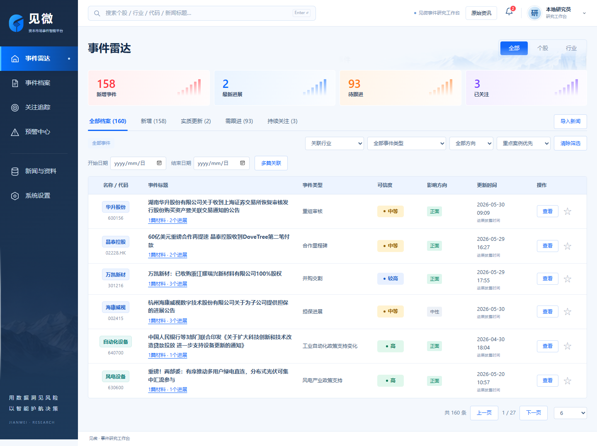

# 见微

**你的市场洞察助手。** 从一条新闻，追到一件事的来龙去脉。

见微面向上市公司与行业事件研究，支持新闻导入、事件识别、事项关联、可信度与影响判断，在事件雷达、事件档案、关注追踪、预警中心四个页面中展示和保存结果。

## 1. 参赛材料

| 序号 | 提交项 | 查看入口 |
| --- | --- | --- |
| 1 | 可运行原型系统 | [Windows 运行包与部署说明](01_可运行原型系统/) |
| 2 | 完整源代码 | [源码、运行资源与测试](02_源代码/) |
| 3 | 技术报告 | [问题理解、技术路线、架构与效果评估](03_技术报告.md) |
| 4 | 数据说明 | [数据来源、字段、预处理与使用限制](04_数据说明.md) |
| 5 | 模型与算法说明 | [方法原理、实现方式与参数设置](05_模型与算法说明.md) |
| 6 | 测试结果与案例展示 | [功能测试与王府井案例](06_测试结果与案例展示.md) |
| 7 | 演示视频 | **[点击观看演示](https://lixiaoying612-byte.github.io/contest-entry-JianWei/)** · [MP4 原文件](07_演示视频.mp4)（3 分 02 秒，1080p） |
| 8 | README | 本页：环境、部署、配置、运行、测试及常见问题 |



## 2. Windows 直接运行

适用环境：**Windows 10/11、x64**。运行包自带 Python 3.12.14 及所需依赖，无需安装 Python、下载模型或注册登录。

1. 下载 [见微 Windows 运行包](https://github.com/lixiaoying612-byte/contest-entry-JianWei/raw/refs/heads/main/01_可运行原型系统/见微_Windows运行包.zip)，完整解压。
2. 打开解压后的 `见微` 文件夹，双击 **`启动见微.cmd`**。
3. 浏览器自动打开系统。未自动打开时，访问 [本地见微](http://127.0.0.1:8780/?mode=real&run=training-showcase)。
4. 保留启动窗口；关闭窗口或按 `Ctrl+C` 停止。再次启动会保留已导入新闻和操作记录。

系统默认载入 **160 条保存事件**。浏览已有案例、原文与时间线，以及关注、已读、待办等操作可离线完成。新新闻分析需要联网访问 DeepSeek；已预配参赛演示凭据，用户点击分析后才发送请求。凭据失效或额度不足时可更换自己的密钥。

在解压目录的命令提示符中，可选择离线模式或其他端口：

```bat
启动见微.cmd --offline
启动见微.cmd --port 8781
```

## 3. 源码部署与依赖

完整源码位于 `02_源代码`，采用 Python 本地服务、SQLite 与 HTML/CSS/JavaScript，无需前端构建、Node.js 或 GPU。

| 环境或依赖 | 版本 |
| --- | --- |
| Python | 3.12 或更新版本；运行包使用 3.12.14 |
| psutil | 7.2.2 |
| numpy | 2.5.3 |
| bm25s | 0.3.11 |

Windows PowerShell：

```powershell
git clone https://github.com/lixiaoying612-byte/contest-entry-JianWei.git
cd contest-entry-JianWei/02_源代码
py -3.12 -m venv .venv
.\.venv\Scripts\python.exe -m pip install -r requirements.txt
.\.venv\Scripts\python.exe scripts/open_competition.py
```

Linux/macOS 可使用源码部署：

```bash
cd "02_源代码"
python3 -m venv .venv
.venv/bin/python -m pip install -r requirements.txt
.venv/bin/python scripts/open_competition.py --no-browser
```

本次部署验证在 Windows x64 完成；Linux/macOS 尚未实机验证。服务默认仅监听本机 `127.0.0.1:8780`。模块划分及主要处理路径见 [源码说明](02_源代码/README.md)。

## 4. 使用与案例复现

1. **事件雷达**：分别查看公司与行业新闻，按对象、事件类型或方向筛选。
2. **事件档案**：查看摘要、对象、可信度、原文依据、来源关系、时间线及影响判断。
3. **导入新闻**：支持文本、CSV 和 XLSX。填写标题、正文、来源、发布时间；批量导入先预览再提交，每批最多 30 篇、文件最大 1 MB。
4. **分析与更新**：选择“导入并分析”，或“仅保存”后在“我的导入”中点击“分析”。每篇每次主动分析最多两次模型发送，结果保存后可回查。
5. **持续跟踪**：关注事件、保存待办，在关注追踪和预警中心查看变化。

复现王府井案例：搜索 `王府井` 或 `600859`，打开股权转让档案，核对终止转让摘要、综合可信度 **95**、对象影响分 **55**、三个进展节点及四篇关联报道。详细操作与输出见 [测试结果与案例展示](06_测试结果与案例展示.md)。

运行包的初始库已包含终止公告；视频使用隔离案例展示导入前后的变化。重复导入已有公告会复用材料。已有结果可按报告复现，新输入的模型输出随新闻内容和模型响应变化。

## 5. 配置与数据保存

配置文件为源码或运行包中的 `config/deepseek.json`，修改后重启生效。

| 配置项 | 说明 |
| --- | --- |
| `api_key` | 参赛演示凭据，可替换为自己的 DeepSeek 密钥 |
| `port` | 默认 `8780` |
| `send_model` | 默认 `true`；设为 `false` 关闭新模型分析 |
| `model_budget_rmb` | 默认 `3`，为本地调用账本上限，另受分阶段预算约束 |
| 环境变量 `DEEPSEEK_API_KEY` | 优先于配置文件中的密钥 |

两轮分析均使用 `deepseek-flash`。运行包中可通过下列命令交互更换密钥，无需把密钥写在命令中：

```bat
python\python.exe scripts\configure_competition_key.py
```

首次启动从压缩示例库安装工作库；后续启动保留已有数据。新闻、事件版本、关注和待办保存在 `artifacts/eng063/local/`。备份时先停止服务，再复制该文件夹。数据字段和使用范围见 [数据说明](04_数据说明.md)。

## 6. 测试与指标复算

在运行包的 `见微` 目录执行功能测试：

```bat
python\python.exe -X utf8 -I -m unittest discover -s tests -v
```

已验证结果为 **27 项通过**。测试使用临时工作区、保存答复和本地模拟服务，不调用收费模型，覆盖两次发送上限、超时处理、数据保护、部署与新闻入档流程。

复算报告中的历史识别比例和处理耗时：

```bat
python\python.exe -X utf8 -I scripts\reproduce_report_metrics.py
```

源码部署时将 `python\python.exe` 替换为 `.\.venv\Scripts\python.exe`。复算使用随包保存的标签和执行记录，不重新生成模型预测；对话识别指标、程序耗时与功能通过率分别统计。具体口径见 [复算说明](02_源代码/reproducibility/README.md) 和 [技术报告](03_技术报告.md)。

## 7. 常见问题

| 情况 | 处理方式 |
| --- | --- |
| 双击后没有页面 | 完整解压到可写的本地目录，查看启动窗口，并手动打开窗口中的地址。 |
| 找不到 Python 或依赖 | 使用第 1 项自带环境的 Windows 运行包，或按源码部署步骤安装依赖。 |
| 端口被占用 | 停止之前的见微，或用 `--port 8781` 启动。 |
| 密钥失效、额度不足或网络异常 | 检查 DeepSeek 账号和网络，必要时更换密钥；可用 `--offline` 浏览已有案例。 |
| 修改配置后未生效 | 关闭启动窗口后重新启动。 |
| 提示预算或价格配置不一致 | 保留旧账本，使用 `--model-budget-ledger artifacts/eng063/local/model-budget-new.sqlite3` 指定新账本。 |
| 关闭后记录是否保留 | 保留。同一工作区再次启动后可继续查看。 |

## 8. 第三方许可

运行包附 Python 及依赖许可证。演示视频配乐为 **Startup — Alex-Productions**，来源：[作者作品页](https://onsound.eu/track/startup-corporate/)及 [free-stock-music.com](https://www.free-stock-music.com/alex-productions-minimal-technology-corporate-startup.html)，采用 [CC BY 3.0](https://creativecommons.org/licenses/by/3.0/) 许可，配乐经剪辑。
